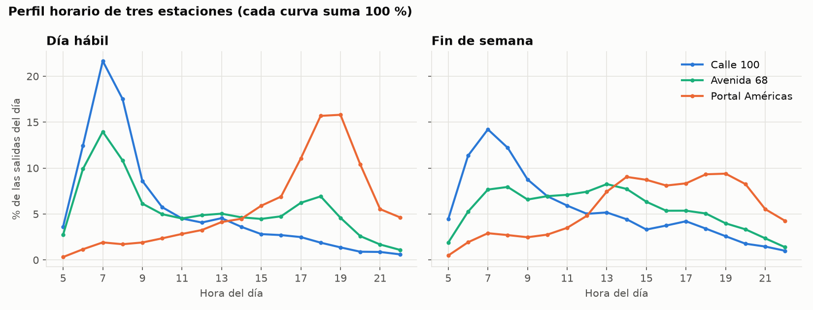

# Descripción de los datos

**Proyecto:** Segmentación de estaciones troncales de TransMilenio por su perfil horario de demanda (aprendizaje no supervisado)
**Curso:** Inteligencia Artificial – Actividad 6 (métodos no supervisados)

Este documento describe la fuente de datos, su estructura original, la limpieza, la transformación y el dataset final que recibe el algoritmo de agrupamiento.

---

## 1. Relación con el proyecto de transporte masivo

En las actividades anteriores se construyó un sistema que encuentra la mejor ruta entre dos estaciones de TransMilenio (actividad 3) y un modelo supervisado que predice la congestión de cada estación por hora (actividad 5).

En esta actividad no hay una variable objetivo: se busca **descubrir, sin etiquetas, qué tipos de estaciones existen** según cómo se reparte su demanda a lo largo del día. El resultado es una segmentación de las 152 estaciones troncales que permite, por ejemplo, ajustar la penalización de transbordo del sistema de rutas según el tipo de estación y la hora.

## 2. Fuentes de datos identificadas

| Fuente | Contenido | Uso en el proyecto |
|---|---|---|
| **Consolidado de Salidas Sistema Troncal por Franja Horaria** | Salidas de usuarios por estación y acceso, cada 15 minutos, un CSV por mes | **Fuente principal** |
| Validaciones Diarias (troncal, zonal, dual, cable) | Cada validación de tarjeta TuLlave: estación, fecha y hora, perfil, tarifa | No se usó: archivos muy grandes y con datos de tarjetas (número, saldo) |
| Estaciones Troncales de TransMilenio (geodatos) | Ubicación de las estaciones troncales | Referencia para relacionar los grupos con el territorio |

**Ficha de la fuente principal**

| Campo | Valor |
|---|---|
| Nombre | Consolidado de Salidas Sistema Troncal por Franja Horaria |
| Publicador | Empresa de Transporte del Tercer Milenio – TRANSMILENIO S.A. |
| Portal | https://datosabiertos.bogota.gov.co/dataset/consolidado-de-salidas-sistema-troncal-por-franja-horaria |
| Licencia | Creative Commons Attribution 4.0 (CC BY 4.0) |
| Periodo usado | Abril de 2024 (1 al 30 de abril) |
| Archivo en el repositorio | `data/raw/salidas_troncal_abril_2024.csv` (sin modificar) |

> **Atribución:** datos de TRANSMILENIO S.A., publicados en Datos Abiertos Bogotá bajo licencia CC BY 4.0.

Se eligió abril de 2024 porque es un mes completo y sin festivos en Colombia: cuatro semanas homogéneas de días hábiles, sábados y domingos.

## 3. Estructura del archivo original

- CSV separado por punto y coma (`;`), codificación Windows-1252, 10,6 MB, 96.455 filas.
- Cada fila es **un acceso de una estación en un intervalo de 15 minutos**, con una columna por día del mes.

| Columna | Tipo | Descripción |
|---|---|---|
| `Línea` | texto | Zona troncal con su código. Ej.: `(36) Zona A Caracas` |
| `Estación` | texto | Estación troncal con su código. Ej.: `(09122) Calle 72` |
| `Acceso de Estación` | texto | Acceso por el que salen los usuarios |
| `MES` | texto | Mes de la medición |
| `INTERVALO` | hora | Inicio de la ventana de 15 minutos |
| `DÍA 01` … `DÍA 31` | entero | Salidas de ese día en ese acceso e intervalo |
| `Total general` | entero | Suma del mes |

## 4. Problemas de calidad y solución

| Problema | Solución |
|---|---|
| 44.731 filas vacías al final del archivo | Se eliminan |
| `DÍA 31` contiene `X` (abril tiene 30 días) | Se ignora |
| 1.492 valores con punto como separador de miles (`1.026` = 1026) | Se quita el punto antes de convertir |
| 2 corrales de buses y 1 biciparqueadero no son estaciones de pasajeros | Se excluyen |
| Entre la 01:00 y las 03:00 casi no hay registros | Se usa solo el horario de 05:00 a 22:59 |

Para validar la limpieza se comprobó que en cada fila la suma de los días coincide con `Total general` (se cumple en el 100 % de las filas).

## 5. Transformación

El script `src/preparar_datos.py` genera dos archivos:

1. **`data/processed/salidas_por_hora.csv`** – una fila por estación, día y hora: 152 estaciones × 30 días × 18 horas = **82.080 filas**, con 60.962.639 salidas en el mes.
2. **`data/processed/perfiles_estaciones.csv`** – **una fila por estación** con su perfil horario. **Es la entrada del agrupamiento.**

### ¿Cómo se construye el perfil de una estación?

1. Se promedian las salidas de cada hora en los **días hábiles** (22 días) y, por separado, en los **fines de semana** (8 días: 4 sábados y 4 domingos).
2. Cada promedio se divide por el total del día y se multiplica por 100. Así cada hora queda expresada como **% de las salidas del día**, y cada bloque de 18 horas suma 100.

**¿Por qué porcentajes y no salidas absolutas?** El objetivo es agrupar por la **forma** de la demanda (a qué hora sale la gente), no por el tamaño de la estación. Con valores absolutos el algoritmo solo separaría los portales gigantes de las estaciones pequeñas. Con porcentajes, una estación pequeña y un portal pueden quedar en el mismo grupo si su gente sale a las mismas horas.

**¿Por qué no se estandarizan las variables?** Las 36 variables están en la misma unidad (% del día) y sus diferencias tienen significado directo: estandarizarlas daría el mismo peso a las 5:00 que a las 7:00, aunque a las 5:00 casi nadie sale.

### Diccionario de `perfiles_estaciones.csv`

| Columna | Descripción | Entra al modelo |
|---|---|---|
| `codigo_estacion`, `estacion` | Identificación de la estación | No |
| `codigo_zona`, `zona` | Zona troncal | No |
| `num_accesos`, `es_portal` | Número de accesos; 1 si es portal o cabecera | No |
| `H05` … `H22` | % de las salidas de un día hábil promedio en cada hora | **Sí (18)** |
| `F05` … `F22` | % de las salidas de un día de fin de semana promedio en cada hora | **Sí (18)** |
| `salidas_dia_habil` | Salidas en un día hábil promedio | No (descriptiva) |
| `salidas_dia_finde` | Salidas en un día de fin de semana promedio | No (descriptiva) |
| `relacion_finde_habil` | Salidas fin de semana / salidas día hábil | No (descriptiva) |
| `pct_punta_manana` | % de salidas de día hábil entre 6:00 y 8:59 | No (descriptiva) |
| `pct_punta_tarde` | % de salidas de día hábil entre 16:00 y 19:59 | No (descriptiva) |

Las columnas descriptivas no entran al algoritmo; se usan después para **interpretar** los grupos.

La figura muestra tres comportamientos muy distintos: en Calle 100 la gente **llega** en la mañana (sale de la estación a las 7:00), en Portal Américas la gente **regresa a casa** en la tarde (sale a las 18:00–19:00) y Avenida 68 tiene los dos picos. Encontrar estos tipos de forma automática es el objetivo del agrupamiento.

## 6. Limitaciones de los datos

- Solo se registran **salidas** del componente troncal; no hay entradas ni datos del componente zonal.
- Un mes de datos: no se observan vacaciones ni festivos.
- Los eventos masivos alteran el perfil de algunas estaciones: durante la Feria del Libro (17 de abril – 2 de mayo de 2024) Recinto Ferial tuvo más salidas en fin de semana que en días hábiles.
