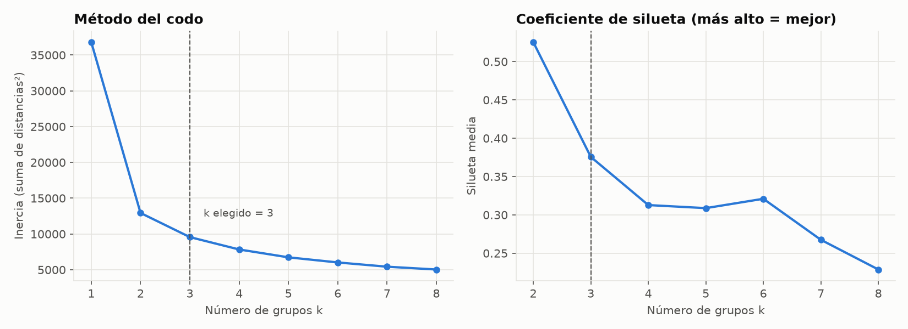
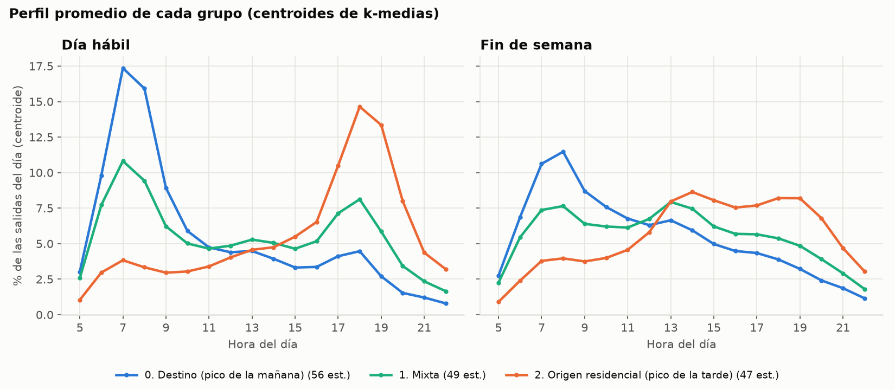
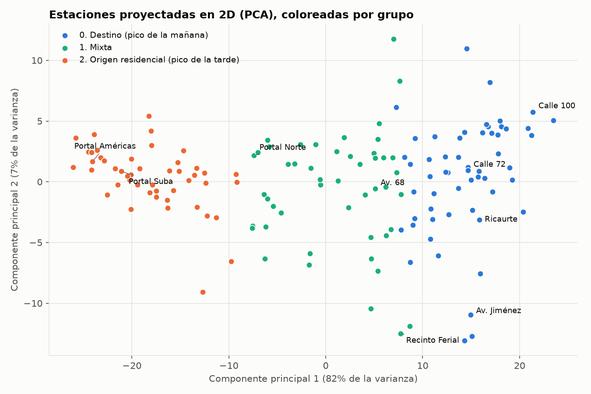
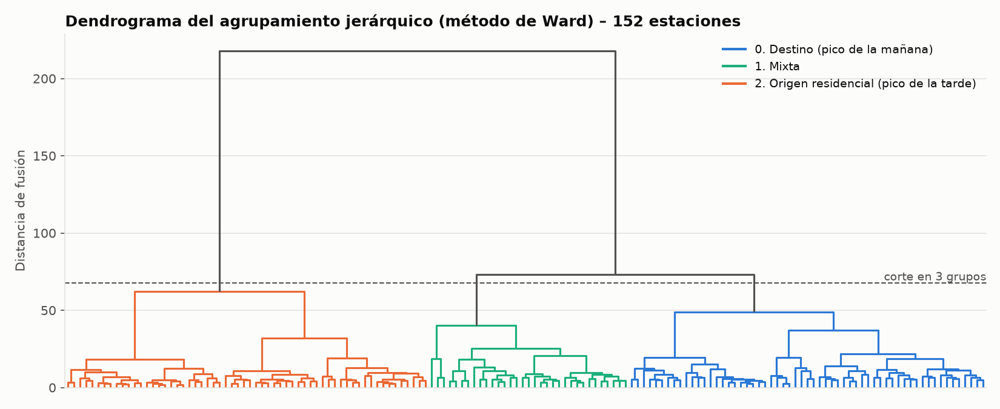

# Documento de pruebas

**Proyecto:** Segmentación de estaciones troncales de TransMilenio por su perfil horario de demanda
**Componente probado:** preparación de datos (`src/preparar_datos.py`), agrupamiento (`src/agrupar.py`, `src/kmedias.py`) y consulta por consola (`src/consultar.py`)
**Entorno:** Python 3.13 · pandas 3.0 · scikit-learn 1.9 · SciPy 1.18 · pytest 9.1

En un problema no supervisado no existe una "respuesta correcta" para medir exactitud. Por eso las pruebas evalúan cinco aspectos:

1. **Calidad interna** de los grupos: inercia, coeficiente de silueta e índice de Davies-Bouldin.
2. **Fidelidad a la teoría** del capítulo 16: la implementación propia de k-medias y los cálculos manuales deben coincidir con scikit-learn.
3. **Estabilidad**: los grupos no deben depender de la semilla aleatoria ni del periodo de datos.
4. **Coherencia con otro método**: comparación con el agrupamiento jerárquico de Ward.
5. **Interpretabilidad y funcionamiento**: los grupos deben tener sentido y la consulta por consola debe manejar bien las entradas.

---

## 1. Selección del número de grupos

Se ejecutó k-medias (50 inicializaciones por valor) para k = 1 a 8:

| k | Inercia | Silueta media | Davies-Bouldin | Tamaño de los grupos |
|---:|---:|---:|---:|---|
| 1 | 36.812 | — | — | 152 |
| 2 | 12.935 | 0,525 | 0,665 | 89, 63 |
| **3** | **9.563** | **0,376** | **1,006** | **56, 49, 47** |
| 4 | 7.834 | 0,313 | 1,174 | 49, 38, 34, 31 |
| 5 | 6.734 | 0,309 | 1,150 | 37, 36, 28, 28, 23 |
| 6 | 6.021 | 0,321 | 1,070 | 37, 36, 29, 29, 18, 3 |
| 7 | 5.425 | 0,268 | 1,163 | 31, 26, 24, 24, 22, 20, 5 |
| 8 | 5.033 | 0,229 | 1,258 | 25, 24, 22, 20, 20, 20, 18, 3 |



**Decisión: k = 3.**

- El codo más marcado está en k = 2 (la inercia cae de 36.812 a 12.935) y k = 2 tiene la mejor silueta (0,525). Sin embargo, con k = 2 el algoritmo solo separa las estaciones con pico en la tarde de todas las demás.
- Con k = 3 aparece un grupo intermedio con sentido propio (estaciones con los dos picos), la silueta sigue siendo la segunda mejor (0,376) y ninguna estación queda con silueta negativa.
- El dendrograma de Ward (sección 4) también muestra tres ramas claras.
- Desde k = 4 la silueta baja y aparecen grupos muy pequeños (de 3 a 5 estaciones en k = 6, 7 y 8).

## 2. Resultado del agrupamiento (k = 3)

| Grupo | Estaciones | Hora pico hábil | % punta mañana | % punta tarde | Fin de semana / hábil | Silueta media |
|---|---:|---:|---:|---:|---:|---:|
| 0. Destino (pico de la mañana) | 56 | 7:00 | 43,1 % | 14,7 % | 0,49 | 0,347 |
| 1. Mixta | 49 | 7:00 | 28,0 % | 26,3 % | 0,59 | 0,225 |
| 2. Origen residencial (pico de la tarde) | 47 | 18:00 | 10,1 % | 45,0 % | 0,63 | 0,567 |



**Interpretación**

- **Grupo 0 – Destino (pico de la mañana):** la gente **llega** a estas estaciones en la mañana para trabajar o estudiar. Incluye los corredores de oficinas y universidades: Calle 100, Calle 76, Marly, Calle 127 y Av. Jiménez. Su demanda cae a la mitad el fin de semana (0,49).
- **Grupo 2 – Origen residencial (pico de la tarde):** la gente **regresa a casa** en la tarde. Incluye 7 de los 10 portales y estaciones del sur, el occidente y Suba: Portal Américas, Portal Suba, Portal Sur, Portal 80 y Portal Usme. Es el grupo con más salidas totales.
- **Grupo 1 – Mixta:** estaciones con los dos picos, que son a la vez destino y origen, como Normandía, Carrera 53, Hortúa, Avenida 68 y NQS Calle 30 Sur. También incluye Portal Norte y Portal El Dorado, que además de barrios residenciales reciben trabajadores.



La primera componente principal explica el 82 % de la varianza y ordena las estaciones casi exactamente de "destino" a "origen": los tres grupos aparecen como franjas consecutivas.

**Distribución por zona troncal**

| Zona | Destino | Mixta | Origen residencial |
|---|---:|---:|---:|
| Zona A Caracas | 9 | 3 | 0 |
| Zona B AutoNorte | 7 | 9 | 1 |
| Zona C Av. Suba | 9 | 1 | 4 |
| Zona D Calle 80 | 2 | 6 | 6 |
| Zona E NQS Central | 12 | 1 | 0 |
| Zona F Av. Américas | 0 | 3 | 6 |
| Zona F Calle 13 | 4 | 3 | 0 |
| Zona G NQS Sur | 0 | 4 | 13 |
| Zona H Caracas Sur | 0 | 7 | 10 |
| Zona J Eje Ambiental | 3 | 0 | 0 |
| Zona K Calle 26 | 6 | 8 | 0 |
| Zona L Carrera 10 | 3 | 4 | 4 |
| Zona T Ciudad Bolívar | 1 | 0 | 3 |

La segmentación coincide con la geografía de Bogotá: las troncales del norte y del centro (Caracas, NQS Central, Eje Ambiental) son destinos, y las del sur (NQS Sur, Caracas Sur, Américas) son origen residencial.

## 3. Verificación de la teoría del capítulo 16

El script `src/kmedias.py` implementa k-medias desde cero (algoritmo de Lloyd: asignar cada estación al centroide más cercano y recalcular cada centroide como la media de su grupo, hasta que nada cambie). Partiendo de los mismos centroides iniciales que scikit-learn:

| Comprobación | Implementación propia | scikit-learn |
|---|---|---|
| Asignación de las 152 estaciones | idéntica | idéntica |
| Inercia final | 9563,2 | 9563,2 |
| Diferencia máxima entre centroides | 7×10⁻¹⁵ | — |
| Iteraciones hasta converger | 5 | — |
| Silueta de Calle 72 (fórmula s = (b − a) / max(a, b)) | 0,4923 | 0,4923 |

Evolución de la inercia en cada iteración de la implementación propia: 10.119 → 9.742 → 9.572 → 9.563 → 9.563. La inercia nunca aumenta, como garantiza el algoritmo.

## 4. Comparación con el agrupamiento jerárquico (Ward)



| k-medias \ Ward | Destino | Mixta | Origen |
|---|---:|---:|---:|
| Destino | 54 | 2 | 0 |
| Mixta | 5 | 31 | 13 |
| Origen | 0 | 0 | 47 |

Los dos métodos coinciden en el **86,8 %** de las estaciones (índice de Rand ajustado = 0,675). Las 47 estaciones de origen residencial de k-medias también son de origen en Ward. Las diferencias están en la frontera del grupo mixto: Ward pasa 13 estaciones mixtas al grupo de origen y 5 al de destino. Muchas de ellas tienen silueta baja en k-medias (por ejemplo Portal Norte, 0,076; Policarpa, 0,075; Sevillana, 0,091), es decir, son estaciones que realmente están entre dos tipos.

## 5. Estabilidad

| Prueba | Resultado |
|---|---|
| 20 ejecuciones de k-medias con semillas distintas | Índice de Rand ajustado mínimo = 1,000: siempre los mismos grupos |
| Perfiles calculados solo con la 1.ª quincena (1–15 abril), asignados a los centroides | 151 de 152 estaciones en el mismo grupo (99,3 %). Cambia: Recinto Ferial |
| Perfiles calculados solo con la 2.ª quincena (16–30 abril) | 151 de 152 estaciones en el mismo grupo (99,3 %). Cambia: Movistar Arena |

Las dos únicas estaciones que cambian de grupo según la quincena están junto a recintos de eventos (Corferias y el Movistar Arena): la Feria del Libro empezó el 17 de abril y altera su perfil. El resto de la segmentación es estable en el tiempo.

## 6. Pruebas funcionales de la consulta (casos manuales)

| ID | Caso | Comando | Resultado esperado | Resultado obtenido | Estado |
|---|---|---|---|---|---|
| C1 | Resumen de los grupos | `--resumen` | Tabla con 3 grupos | 56, 49 y 47 estaciones | ✅ |
| C2 | Estación típica de destino | `--estacion "Calle 72"` | Grupo 0, silueta alta | Grupo 0, silueta 0,492 | ✅ |
| C3 | Portal con nombre sin tilde | `--estacion "portal americas"` | Grupo 2 | Grupo 2, silueta 0,676 | ✅ |
| C4 | Nombre popular de un portal | `--estacion "portal norte"` | Encuentra Cabecera Autopista Norte | Grupo 1, en la frontera (silueta 0,076) | ✅ |
| C5 | Estación afectada por un evento | `--estacion "Recinto Ferial"` | Silueta baja | Grupo 1, silueta 0,053, fin de semana/hábil = 1,10 | ✅ |
| C6 | Distancia entre dos estaciones | `--comparar "Calle 72" "Portal Americas"` | Distancia euclidiana grande | 38,90; mayor diferencia a las 7:00 | ✅ |
| C7 | Listar un grupo | `--grupo 1` | 49 estaciones ordenadas | 49 estaciones, de la más a la menos típica | ✅ |
| C8 | Nombre ambiguo | `--estacion calle` | Lista de coincidencias | Error con 25 opciones, código 1 | ✅ |
| C9 | Estación inexistente | `--estacion xyz` | Mensaje de error | "No se encontró la estación", código 1 | ✅ |
| C10 | Grupo inexistente | `--grupo 7` | Mensaje de error | "El grupo debe estar entre 0 y 2", código 1 | ✅ |

### Salidas de consola

**C1**

```
$ python src/consultar.py --resumen
152 estaciones agrupadas en 3 grupos con k-medias

Grupo                                         Est.  Pico hábil  Punta AM  Punta PM  Finde/hábil
0. Destino (pico de la mañana)                  56         7:00     43.1%     14.7%         0.49
1. Mixta                                        49         7:00     28.0%     26.3%         0.59
2. Origen residencial (pico de la tarde)        47        18:00     10.1%     45.0%         0.63
[código de salida: 0]
```

**C2**

```
$ python src/consultar.py --estacion "Calle 72"
Estación: Calle 72 (09122) – Zona A Caracas
Grupo:    0. Destino (pico de la mañana)

Perfil de la estación:
  Salidas en un día hábil promedio:  21,587
  Hora pico día hábil / fin de semana: 7:00 / 8:00
  % de salidas en la punta de la mañana (6-9 h): 44.0 %
  % de salidas en la punta de la tarde (16-20 h): 14.2 %
  Fin de semana / día hábil: 0.39

Distancia euclidiana a cada centroide (el grupo es el más cercano):
  Grupo 0 (Destino (pico de la mañana)):   3.13  <- asignado
  Grupo 1 (Mixta):  14.98
  Grupo 2 (Origen residencial (pico de la tarde)):  32.89

Coeficiente de silueta: 0.492 (bien ubicada)

Las 5 estaciones con el perfil más parecido:
  Flores – Areandina                       grupo 0  distancia  4.74
  Av. El Dorado                            grupo 0  distancia  5.10
  Calle 76 - San Felipe                    grupo 0  distancia  5.33
  SUBA - CALLE 100                         grupo 0  distancia  5.33
  Calle 85                                 grupo 0  distancia  5.55
[código de salida: 0]
```

**C3**

```
$ python src/consultar.py --estacion "portal americas"
Estación: Portal Américas (05000) – Zona F Av. Américas
Grupo:    2. Origen residencial (pico de la tarde)

Perfil de la estación:
  Salidas en un día hábil promedio:  85,449
  Hora pico día hábil / fin de semana: 19:00 / 19:00
  % de salidas en la punta de la mañana (6-9 h): 4.8 %
  % de salidas en la punta de la tarde (16-20 h): 49.5 %
  Fin de semana / día hábil: 0.59

Distancia euclidiana a cada centroide (el grupo es el más cercano):
  Grupo 0 (Destino (pico de la mañana)):  38.54
  Grupo 1 (Mixta):  25.52
  Grupo 2 (Origen residencial (pico de la tarde)):   6.81  <- asignado

Coeficiente de silueta: 0.676 (bien ubicada)

Las 5 estaciones con el perfil más parecido:
  Portal Sur JFK Coop. Financiera          grupo 2  distancia  1.83
  Molinos                                  grupo 2  distancia  2.21
  SAN MATEO - C.C. UNISUR                  grupo 2  distancia  2.85
  Cabecera Usme                            grupo 2  distancia  3.14
  LEON XIII                                grupo 2  distancia  3.28
[código de salida: 0]
```

**C4**

```
$ python src/consultar.py --estacion "portal norte"
Estación: Cabecera Autopista Norte (02000) – Zona B AutoNorte
Grupo:    1. Mixta

Perfil de la estación:
  Salidas en un día hábil promedio:  82,374
  Hora pico día hábil / fin de semana: 18:00 / 13:00
  % de salidas en la punta de la mañana (6-9 h): 20.8 %
  % de salidas en la punta de la tarde (16-20 h): 34.5 %
  Fin de semana / día hábil: 0.62

Distancia euclidiana a cada centroide (el grupo es el más cercano):
  Grupo 0 (Destino (pico de la mañana)):  22.65
  Grupo 1 (Mixta):   9.58  <- asignado
  Grupo 2 (Origen residencial (pico de la tarde)):  12.13

Coeficiente de silueta: 0.076 (en la frontera entre grupos)

Las 5 estaciones con el perfil más parecido:
  SEVILLANA                                grupo 1  distancia  4.71
  COMUNEROS                                grupo 1  distancia  4.80
  Marsella                                 grupo 2  distancia  4.82
  Portal Eldorado                          grupo 1  distancia  5.15
  NQS - Calle 30 Sur                       grupo 1  distancia  5.97
[código de salida: 0]
```

**C5**

```
$ python src/consultar.py --estacion "Recinto Ferial"
Estación: Recinto Ferial (06106) – Zona K Calle 26
Grupo:    1. Mixta

Perfil de la estación:
  Salidas en un día hábil promedio:  8,126
  Hora pico día hábil / fin de semana: 7:00 / 11:00
  % de salidas en la punta de la mañana (6-9 h): 31.3 %
  % de salidas en la punta de la tarde (16-20 h): 15.0 %
  Fin de semana / día hábil: 1.10

Distancia euclidiana a cada centroide (el grupo es el más cercano):
  Grupo 0 (Destino (pico de la mañana)):  17.13
  Grupo 1 (Mixta):  15.64  <- asignado
  Grupo 2 (Origen residencial (pico de la tarde)):  30.08

Coeficiente de silueta: 0.053 (en la frontera entre grupos)

Las 5 estaciones con el perfil más parecido:
  Salitre El Greco                         grupo 1  distancia  8.82
  Calle 19                                 grupo 1  distancia 11.14
  La Sabana                                grupo 1  distancia 11.16
  Pradera                                  grupo 1  distancia 11.46
  EL CAMPIN                                grupo 1  distancia 11.62
[código de salida: 0]
```

**C6**

```
$ python src/consultar.py --comparar "Calle 72" "Portal Americas"
Calle 72 (grupo 0)  vs  Portal Américas (grupo 2)

Horas con mayor diferencia en el perfil (puntos porcentuales):
  H07:  18.5 % vs   1.9 %  (diferencia +16.5)
  H08:  16.6 % vs   1.7 %  (diferencia +14.9)
  H19:   2.4 % vs  15.8 %  (diferencia -13.4)
  H18:   5.4 % vs  15.7 %  (diferencia -10.3)
  F08:  12.7 % vs   2.7 %  (diferencia +10.0)

Distancia euclidiana = raíz(suma de las 36 diferencias al cuadrado) = 38.90
[código de salida: 0]
```

**C7**

```
$ python src/consultar.py --grupo 1
Grupo 1. Mixta: 49 estaciones (de la más típica a la menos típica)

Estación                                 Zona                      Dist.  Silueta  Salidas/día
Normandía                                Zona K Calle 26            4.04    0.373        8,341
Carrera 53                               Zona D Calle 80            4.25    0.365        4,510
Hortúa                                   Zona H Caracas Sur         4.46    0.415       11,649
Avenida 68                               Zona D Calle 80            5.18    0.251       11,670
NQS - Calle 30 Sur                       Zona G NQS Sur             5.25    0.409        7,053
Las Ferias                               Zona D Calle 80            5.63    0.292        4,334
Calle 142                                Zona B AutoNorte           5.66    0.454       11,520
   … (39 estaciones más)
[código de salida: 0]
```

**C8**

```
$ python src/consultar.py --estacion calle
Error: 'calle' es ambiguo. Coincide con: Av. Suba- Calle 116, Cabecera Calle 80, Calle 100 - Marketmedios, Calle 106, Calle 127, Calle 142, Calle 146, Calle 161, Calle 19, Calle 22, Calle 26, Calle 34, Calle 40 Sur, Calle 45, Calle 57, Calle 63, Calle 72, Calle 75 - Zona M, Calle 76 - San Felipe, Calle 85, NIZA - CALLE 127, NQS - Calle 30 Sur, NQS - Calle 38A Sur, SUBA - CALLE 100, SUBA - CALLE 95
[código de salida: 1]
```

**C9**

```
$ python src/consultar.py --estacion xyz
Error: No se encontró la estación 'xyz'. Use --listar para ver los nombres disponibles.
[código de salida: 1]
```

**C10**

```
$ python src/consultar.py --grupo 7
Error: El grupo debe estar entre 0 y 2.
[código de salida: 1]
```

## 7. Pruebas automáticas (`pytest`)

Ejecución:

```
python -m pytest -v
```

Resultado: **39 pruebas superadas, 0 fallidas.**

| # | Archivo | Prueba | Qué verifica |
|---|---|---|---|
| 1 | test_agrupamiento.py | `test_distancia_euclidiana_conocida` | d((0,0),(3,4)) = 5 |
| 2 | test_agrupamiento.py | `test_kmedias_propio_en_ejemplo_de_libro` | K-medias propio separa dos nubes de puntos evidentes |
| 3 | test_agrupamiento.py | `test_la_inercia_nunca_aumenta` | La inercia no aumenta entre iteraciones |
| 4 | test_agrupamiento.py | `test_kmedias_propio_igual_a_sklearn` | Implementación propia = scikit-learn con los datos reales |
| 5 | test_agrupamiento.py | `test_silueta_manual_igual_a_sklearn` | La fórmula de silueta manual = scikit-learn |
| 6 | test_agrupamiento.py | `test_tres_grupos_y_todas_las_estaciones_asignadas` | 3 grupos, 152 estaciones, ninguno marginal |
| 7 | test_agrupamiento.py | `test_cada_estacion_esta_en_el_grupo_del_centroide_mas_cercano` | Regla de asignación de k-medias |
| 8 | test_agrupamiento.py | `test_centroide_es_la_media_de_su_grupo` | Regla de actualización de k-medias |
| 9 | test_agrupamiento.py | `test_calidad_minima_del_agrupamiento` | Silueta media > 0,3 y ninguna estación con silueta negativa |
| 10 | test_agrupamiento.py | `test_estable_frente_a_la_semilla` | Mismos grupos con distintas semillas |
| 11 | test_agrupamiento.py | `test_estable_entre_quincenas` | ≥ 95 % de estaciones en el mismo grupo en cada quincena |
| 12 | test_agrupamiento.py | `test_ward_coincide_con_kmedias_en_la_mayoria` | Ward coincide con k-medias en ≥ 80 % |
| 13 | test_agrupamiento.py | `test_ordenar_grupos_es_determinista` | La numeración de los grupos no depende del azar |
| 14 | test_agrupamiento.py | `test_estaciones_conocidas_en_el_grupo_esperado[Calle 72-0]` | Estaciones conocidas quedan en el grupo esperado |
| 15 | test_agrupamiento.py | `test_estaciones_conocidas_en_el_grupo_esperado[Calle 100 - Marketmedios-0]` | Estaciones conocidas quedan en el grupo esperado |
| 16 | test_agrupamiento.py | `test_estaciones_conocidas_en_el_grupo_esperado[Museo del Oro-0]` | Estaciones conocidas quedan en el grupo esperado |
| 17 | test_agrupamiento.py | `test_estaciones_conocidas_en_el_grupo_esperado[Portal Américas-2]` | Estaciones conocidas quedan en el grupo esperado |
| 18 | test_agrupamiento.py | `test_estaciones_conocidas_en_el_grupo_esperado[Portal Suba-2]` | Estaciones conocidas quedan en el grupo esperado |
| 19 | test_agrupamiento.py | `test_estaciones_conocidas_en_el_grupo_esperado[Cabecera Usme-2]` | Estaciones conocidas quedan en el grupo esperado |
| 20 | test_agrupamiento.py | `test_los_grupos_tienen_el_perfil_que_dice_su_nombre` | Cada grupo tiene el pico que indica su nombre |
| 21 | test_agrupamiento.py | `test_buscar_estacion[09122-Calle 72]` | Búsqueda por código, sin tildes, alias o con errores |
| 22 | test_agrupamiento.py | `test_buscar_estacion[calle 72-Calle 72]` | Búsqueda por código, sin tildes, alias o con errores |
| 23 | test_agrupamiento.py | `test_buscar_estacion[portal norte-Cabecera Autopista Norte]` | Búsqueda por código, sin tildes, alias o con errores |
| 24 | test_agrupamiento.py | `test_buscar_estacion[portal americas-Portal Américas]` | Búsqueda por código, sin tildes, alias o con errores |
| 25 | test_agrupamiento.py | `test_buscar_estacion[Ricuarte-Ricaurte]` | Búsqueda por código, sin tildes, alias o con errores |
| 26 | test_agrupamiento.py | `test_buscar_estacion_invalida[calle]` | Rechaza nombres ambiguos, inexistentes o vacíos |
| 27 | test_agrupamiento.py | `test_buscar_estacion_invalida[xyz123]` | Rechaza nombres ambiguos, inexistentes o vacíos |
| 28 | test_agrupamiento.py | `test_buscar_estacion_invalida[  ]` | Rechaza nombres ambiguos, inexistentes o vacíos |
| 29 | test_agrupamiento.py | `test_cli_codigos_de_salida` | Código 0 si funciona y 1 si hay error |
| 30 | test_datos.py | `test_separador_de_miles` | Convierte '1.026' en 1026 |
| 31 | test_datos.py | `test_separar_codigo_y_nombre` | Separa código y nombre de la estación |
| 32 | test_datos.py | `test_normalizar_quita_tildes_y_signos` | Normaliza nombres para la búsqueda |
| 33 | test_datos.py | `test_limpiar_elimina_vacias_corrales_y_valida_total` | Elimina filas vacías y corrales; detecta totales inconsistentes |
| 34 | test_datos.py | `test_limpieza_conserva_las_salidas` | La limpieza no pierde ni inventa salidas |
| 35 | test_datos.py | `test_dataset_por_hora_completo` | Una fila por estación, día y hora, sin duplicados |
| 36 | test_datos.py | `test_una_fila_por_estacion_y_36_variables` | 152 estaciones × 36 variables, sin valores faltantes |
| 37 | test_datos.py | `test_cada_perfil_suma_100` | Cada bloque (hábil y fin de semana) suma 100 % |
| 38 | test_datos.py | `test_perfil_calculado_a_mano` | El perfil de una estación ficticia coincide con el cálculo a mano |
| 39 | test_datos.py | `test_archivo_de_perfiles_es_reproducible` | El CSV de perfiles del repositorio se regenera igual |

## 8. Conclusión

El agrupamiento cumple su objetivo: sin usar ninguna etiqueta, k-medias encontró tres tipos de estaciones con significado claro (destino, mixta y origen residencial), que coinciden con la geografía de la ciudad. Los grupos son estables frente a la semilla y al periodo (99,3 % y 99,3 %), coinciden en un 86,8 % con el método jerárquico de Ward, y la implementación propia del algoritmo reproduce exactamente el resultado de scikit-learn. La principal limitación es que las estaciones cercanas a recintos de eventos cambian de perfil según el calendario de eventos.
